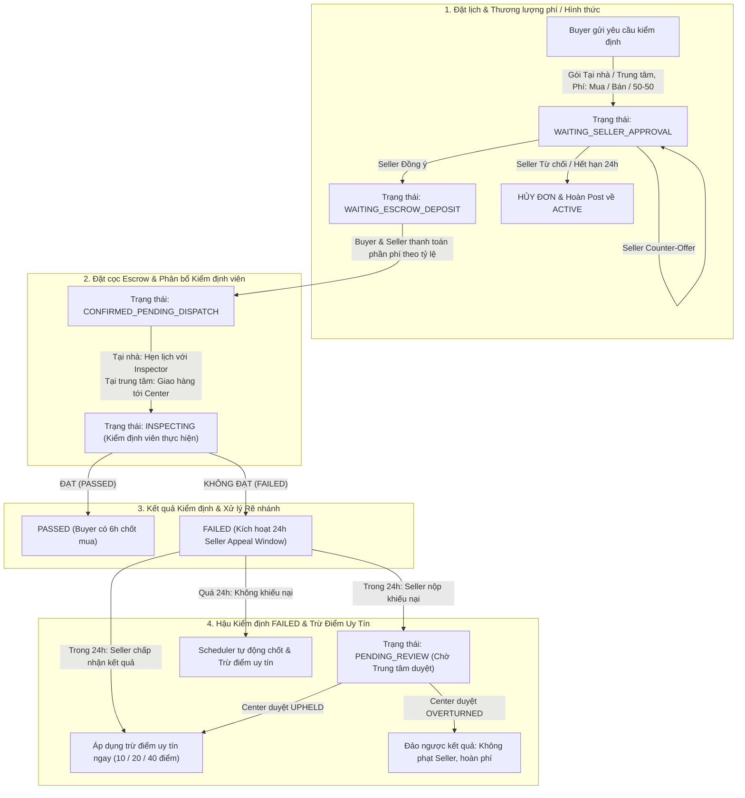

# KẾ HOẠCH TRIỂN KHAI FRONTEND: TOÀN BỘ LUỒNG KIỂM ĐỊNH & MUA BÀI ĐĂNG (INSPECTION & PURCHASE SYSTEM)

Tài liệu này xác định chi tiết kiến trúc giao diện, luồng người dùng (User Flows), thiết kế Component, hợp đồng API (API Contracts) và lộ trình triển khai Frontend cho hệ thống Kiểm định hàng cũ SecondLife.

---

## 1. TỔNG QUAN LUỒNG & STATE MACHINE



---

## 2. KIẾN TRÚC ROUTE & COMPONENT HIERARCHY

```
SEP490_FE_SecondLife/src/
├── components/
│   ├── inspection/
│   │   ├── InspectionQuoteCard.tsx             # Card so sánh 2 gói Tại nhà vs Tại trung tâm + chi tiết phí & bậc thang km
│   │   ├── InspectionFeePayerSelector.tsx      # Radio button chọn Người mua / Người bán / Chia đôi 50-50
│   │   ├── InspectionHomeSchedulerModal.tsx    # Modal người bán & KTV thống nhất ngày giờ kiểm định tại nhà
│   │   ├── InspectionAppealModal.tsx           # Modal nộp khiếu nại kết quả FAILED (lý do, bằng chứng, checklist items)
│   │   ├── InspectionPenaltyPreviewCard.tsx    # Card dự tính số điểm uy tín bị trừ nếu chấp nhận kết quả
│   │   ├── InspectionCountdownTimer.tsx        # Đồng hồ đếm ngược (6h buyer payment / 24h seller appeal)
│   │   └── InspectionChecklistViewer.tsx       # Bảng chi tiết kết quả checklist 100 điểm, các mục fail/pass
│   ├── modals/
│   │   ├── CreateInspectionOrderModal.tsx      # Modal người mua cấu hình đơn kiểm định từ chi tiết bài đăng
│   │   ├── SellerInspectionCounterModal.tsx    # Modal người bán phản hồi đề xuất lại phương án kiểm định
│   │   ├── CenterReviewAppealModal.tsx         # Modal quản lý trung tâm phê duyệt khiếu nại
│   │   └── DigitalInspectionCertificateModal.tsx # Xem chứng chỉ kiểm định điện tử QR Code
├── pages/
│   ├── BuyerInspectionDecisionView.tsx         # [Cập nhật] Màn hình Buyer quyết định mua sau khi PASSED (hạn 6h)
│   ├── SellerDashboardView.tsx                 # [Cập nhật] Tab 'Đơn kiểm định': xử lý yêu cầu, khiếu nại FAILED 24h
│   ├── InspectorPortalView.tsx                 # [Cập nhật] Cổng KTV: đề xuất hẹn giờ tại nhà, checklist, nộp báo cáo
│   └── InspectionCenterDashboardView.tsx       # [Cập nhật] Tab 'Khiếu nại kiểm định': duyệt UPHELD/OVERTURNED
└── services/
    ├── inspectorService.ts                     # [Cập nhật] Bổ sung đầy đủ API endpoints & DTOs
    └── reputationService.ts                    # Tích hợp hiển thị lịch sử phạt uy tín
```

---

## 3. CHI TIẾT GIAO DIỆN & USER EXPERIENCE (UX)

### 3.1. Người Mua (Buyer Flow)

1. **Khởi tạo yêu cầu kiểm định (`CreateInspectionOrderModal`)**:
   - **Chọn hình thức kiểm định**:
     - *Kiểm định tại nhà người bán*: Hiển thị khoảng cách di chuyển (km), phí cơ bản + phụ phí di chuyển theo 6 bậc thang cước.
     - *Kiểm định tại trung tâm*: Hiển thị phí kiểm định tại trạm + phí vận chuyển tới trung tâm + phí ký quỹ chiều về dự phòng (sẽ được hoàn lại nếu mua hàng thành công).
   - **Chọn người chi trả phí**:
     - Người mua chịu 100%.
     - Người bán chịu 100% (cần người bán duyệt).
     - Chia đôi 50% - 50%.
   - **Cam kết zin linh kiện**: Checkbox xác nhận đồng ý cho kỹ thuật viên tháo ốc/mở máy kiểm tra phần cứng bên trong.
   - **Cọc cam kết mua hàng**: Giữ cọc 10% giá trị sản phẩm trong ví Escrow.

2. **Màn hình chốt mua hàng (`BuyerInspectionDecisionView`)**:
   - Khi kiểm định **PASSED**:
     - Đồng hồ đếm ngược **6 giờ** nổi bật trên đầu màn hình.
     - Xem kết quả checklist, điểm đánh giá tổng thể (Overall Condition Score), hình ảnh & video unboxing seal.
     - 2 Nút hành động chính:
       - **"Xác nhận Mua hàng & Thanh toán"**: Chuyển số tiền còn lại (đã trừ cọc cam kết), tự động hoàn trả phí ký quỹ chiều về, tạo đơn vận chuyển tới người mua.
       - **"Từ chối Mua hàng"**: Buyer nhận lại tiền cọc hàng, nhưng chịu toàn bộ chi phí kiểm định và vận chuyển 2 chiều theo quy định.

---

### 3.2. Người Bán (Seller Flow - Trọng tâm 24h Appeal & Uy Tín)

1. **Tiếp nhận & Thương lượng Yêu cầu Kiểm định**:
   - Nhận thông báo realtime qua WebSocket & Chuông thông báo khi có Buyer đặt kiểm định.
   - Các hành động trong vòng 24 giờ:
     - **Chấp thuận (APPROVE)**: Đồng ý với đề xuất của Buyer.
     - **Đề xuất lại (COUNTER)**: Mở `SellerInspectionCounterModal` để:
       - Đổi hình thức: Từ Tại trung tâm sang Tại nhà hoặc ngược lại.
       - Đổi phương án phí: Đề xuất lại người mua trả hoặc chia đôi 50/50.
     - **Từ chối (REJECT)**: Nêu lý do từ chối kiểm định.

2. **Thương lượng Giờ Kiểm định Tại Nhà (AT_HOME)**:
   - Kỹ thuật viên (Inspector) đề xuất khung giờ đến nhà (VD: 09:00 - 11:30 ngày 31/10).
   - Người bán bấm **"Xác nhận giờ hẹn"** hoặc **"Đề xuất khung giờ khác"**.

3. **Xử lý khi Kiểm định Thất Bại (`FAILED`) & Cơ Chế Khiếu Nại 24h**:
   - **Banner cảnh báo khẩn cấp (Emergency Banner)**:
     - Nền cam viền đỏ có biểu tượng chuông cảnh báo: *"Sản phẩm kiểm định KHÔNG ĐẠT. Bạn có 24:00:00 để khiếu nại kết quả trước khi hệ thống tự động ghi nhận lỗi và trừ điểm uy tín."*
     - Đồng hồ đếm ngược `InspectionCountdownTimer` thời gian thực (giây/phút/giờ).
   - **Chi tiết phân tích lỗi Checklist**:
     - Hiển thị danh sách các tiêu chí bị đánh FAILED (ví dụ: màn hình đã thay linh kiện lô, camera bị rung, pin chai > 40%).
     - Box hiển thị tỷ lệ lỗi: `% Failed Items` và phân loại mức độ nghiêm trọng.
   - **2 Nút hành động cho Người bán**:
     - **Nút 1: "Khiếu nại kết quả" (Submit Appeal)**:
       - Mở `InspectionAppealModal`:
         - Nhập lý do khiếu nại (bắt buộc).
         - Chọn các tiêu chí checklist mà người bán không đồng tình (`contestedItemIds`).
         - Đính kèm hình ảnh / video / link chứng cứ hóa đơn xuất xưởng (`evidenceUrls`).
         - Ghi chú thêm cho Quản lý Trung tâm.
       - Sau khi nộp: Chuyển sang trạng thái `PENDING_REVIEW`, đồng hồ 24h tạm dừng chờ kết quả phân xử.
     - **Nút 2: "Chấp nhận kết quả" (Accept Failed Result)**:
       - Hiển thị Dialog xác nhận với cảnh báo minh bạch:
         - *"Bạn đồng ý với kết luận kiểm định. Điểm uy tín của bạn sẽ bị trừ: -XX điểm dựa trên mức độ không khớp với bài đăng."*
         - Nếu xác nhận: Gọi API `/accept-failed`, áp dụng điểm trừ ngay lập tức và giải phóng đơn hàng về trạng thái kết thúc.
   - **Kịch bản Quá 24 giờ không hành động**:
     - Hệ thống tự động trừ điểm uy tín theo công thức backend (`calculateChecklistPenalty`).
     - Banner đổi sang màu đỏ: *"Đã hết thời hạn khiếu nại 24h. Hệ thống đã tự động khấu trừ XX điểm uy tín của bạn do sản phẩm sai lệch với cam kết."*

---

### 3.3. Kỹ Thuật Viên (Inspector Flow - `InspectorPortalView`)

1. **Nhận đơn & Đặt lịch hẹn tại nhà**:
   - Xem địa chỉ người bán, thông tin liên hệ, khoảng cách km và lộ trình di chuyển.
   - Chọn ngày và khung giờ hẹn kiểm định -> Gửi thông báo đến người bán.
2. **Thực hiện kiểm định tại chỗ / tại trạm**:
   - Nhập mã niêm phong (Seal code) hoặc quét mã QR.
   - Từng bước hoàn thiện 5 nhóm tiêu chí kiểm định (Ngoại quan, Màn hình, Hiệu năng/Pin, Tính năng camera/loa/mic, Tình trạng tháo lắp linh kiện zin).
   - Tải lên video bằng chứng bóc tem hoặc video ghi nhận tình trạng máy.
   - Đánh giá Điểm số tổng thể (0 - 100) và Xếp loại chất lượng (POOR / FAIR / GOOD / EXCELLENT).
   - Nhấn **"Chốt kết quả kiểm định"** -> Kích hoạt luồng rẽ nhánh PASSED hoặc FAILED tự động.

---

### 3.4. Quản Lý Trung Tâm (Center Manager Flow - `InspectionCenterDashboardView`)

1. **Tab mới: "Quản lý Khiếu nại Kiểm định" (Inspection Appeals)**:
   - Hiển thị bảng danh sách các đơn khiếu nại cần xử lý:
     - Cột: Mã đơn, Bài đăng, Người bán, Người kiểm định, Thời gian nộp, Trạng thái (`PENDING_REVIEW`).
   - Click xem chi tiết đối soát:
     - Cột trái: Kết quả kiểm định của KTV (Checklist, điểm, video chứng cứ).
     - Cột phải: Đơn khiếu nại của người bán (Lý do, danh sách mục tranh chấp, ảnh/video bằng chứng người bán tải lên).
2. **Quyết định Khiếu nại (`CenterReviewAppealModal`)**:
   - **Bác bỏ khiếu nại (`UPHELD`)**:
     - Nhập lý do bác bỏ (ví dụ: "Video kiểm định KTV ghi nhận rõ ràng cáp màn hình đã qua can thiệp").
     - Kết quả kiểm định FAILED được giữ nguyên -> Kích hoạt trừ điểm uy tín người bán.
   - **Chấp thuận khiếu nại (`OVERTURNED`)**:
     - Nhập lý do chấp thuận (ví dụ: "Người bán cung cấp hóa đơn bảo hành chính hãng hợp lệ, KTV nhầm lẫn phiên bản linh kiện").
     - Hủy quyết định phạt, hoàn trả điểm uy tín (nếu đã trừ), hoàn cọc/phí cho các bên theo chính sách bảo vệ người dùng.

---

## 4. HỢP ĐỒNG API VÀ TYPESCRIPT CLIENT (`inspectorService.ts`)

### 4.1. TypeScript Interface Bổ Sung

```typescript
export type InspectionAppealStatus = 'NONE' | 'PENDING_REVIEW' | 'UPHELD' | 'OVERTURNED';

export interface InspectionAppealRequest {
  reason: string;
  evidenceUrls?: string[];
  contestedItemIds?: string[];
  note?: string;
}

export interface ReviewInspectionAppealRequest {
  decision: 'UPHELD' | 'OVERTURNED';
  resolutionNote: string;
}

export interface InspectionOrderDto {
  id: string;
  orderCode?: string;
  post: {
    id: string;
    title: string;
    price: number;
    images?: string[];
  };
  buyer: {
    id: string;
    fullName: string;
    phoneNumber?: string;
  };
  seller: {
    id: string;
    fullName: string;
    phoneNumber?: string;
  };
  inspector?: {
    id: string;
    fullName: string;
    phoneNumber?: string;
  };
  orderType: 'AT_HOME' | 'AT_CENTER';
  feePayer: 'BUYER_PAYS' | 'SELLER_PAYS' | 'SPLIT_50_50';
  status: string;

  // Chi phí
  inspectionFee: number;
  shippingFee: number;
  travelFee: number;
  travelDistanceKm: number;
  returnShippingReserveFee: number;
  buyerFeeShare: number;
  sellerFeeShare: number;
  buyerCommitmentDeposit: number;

  // Lịch hẹn tại nhà
  appointmentScheduledAt?: string;
  appointmentTimeSlot?: string;
  appointmentStatus?: string;

  // Kết quả kiểm định
  conditionScore?: number;
  conditionGrade?: 'POOR' | 'FAIR' | 'GOOD' | 'EXCELLENT';
  checklistResultJson?: string;
  summaryReport?: string;
  sealNumber?: string;
  certificateCode?: string;
  completedAt?: string;

  // Cơ chế Khiếu nại 24h & Điểm uy tín
  appealDeadline?: string;
  appealStatus?: InspectionAppealStatus;
  appealReason?: string;
  appealEvidenceJson?: string;
  appealResolvedAt?: string;
  appealResolvedByName?: string;
  reputationPenaltyApplied?: boolean;
  reputationPenaltyPoints?: number;
}
```

### 4.2. API Client Methods (`inspectorService.ts`)

```typescript
// Nộp khiếu nại kết quả FAILED (Người bán nộp trong 24h)
submitAppeal: async (orderId: string, req: InspectionAppealRequest): Promise<InspectionOrderDto> => {
  return request(`/inspections/orders/${orderId}/appeal`, {
    method: 'POST',
    body: JSON.stringify(req),
    requiresAuth: true,
  });
},

// Người bán chủ động chấp nhận kết quả FAILED (bị trừ điểm uy tín ngay)
acceptFailedResult: async (orderId: string): Promise<InspectionOrderDto> => {
  return request(`/inspections/orders/${orderId}/accept-failed`, {
    method: 'POST',
    requiresAuth: true,
  });
},

// Quản lý trung tâm duyệt khiếu nại (UPHELD / OVERTURNED)
reviewAppeal: async (orderId: string, req: ReviewInspectionAppealRequest): Promise<InspectionOrderDto> => {
  return request(`/inspections/centers/orders/${orderId}/review-appeal`, {
    method: 'POST',
    body: JSON.stringify(req),
    requiresAuth: true,
  });
},

// Xác nhận giờ hẹn kiểm định tại nhà (Người bán hoặc KTV)
confirmHomeAppointment: async (orderId: string, scheduledAt: string, timeSlot: string): Promise<InspectionOrderDto> => {
  return request(`/inspections/orders/${orderId}/schedule-home`, {
    method: 'POST',
    body: JSON.stringify({ scheduledAt, timeSlot }),
    requiresAuth: true,
  });
}
```

---

## 5. THIẾT KẾ CÔNG THỨC TRỪ ĐIỂM UY TÍN (SELLER UI PREVIEW)

Để người bán luôn nắm rõ hậu quả và tính minh bạch của nền tảng, `InspectionPenaltyPreviewCard.tsx` sẽ tính toán trực tiếp điểm trừ dự kiến dựa trên kết quả kiểm định:

| Tình trạng kiểm định | Mức độ vi phạm | Điểm trừ uy tín (`reputationScore`) | Mức độ cảnh báo |
| :--- | :--- | :--- | :--- |
| **Grade POOR** hoặc **Score < 40** | Vi phạm nghiêm trọng (Gian dối mô tả nặng) | **-40.00 điểm** | Huy hiệu đỏ nguy hiểm, cảnh báo khóa tài khoản bán |
| **Checklist fail > 60%** | Vi phạm rất lớn | **-40.00 điểm** | Huy hiệu đỏ |
| **30% < Checklist fail <= 60%** | Vi phạm mức độ trung bình | **-20.00 điểm** | Huy hiệu cam cảnh báo |
| **Checklist fail <= 30%** | Lỗi nhỏ, hao mòn thực tế không kê khai | **-10.00 điểm** | Huy hiệu vàng nhắc nhở |
| **Không có dữ liệu checklist** | Fallback mặc định | **-15.00 điểm** | Huy hiệu vàng |

---

## 6. LỘ TRÌNH THỰC HIỆN THEO PHASES (MILESTONES)

### Giai đoạn 1: Service & Hooks Core (Nền tảng API)
- [x] Backend hoàn tất 100%, 58 tests passed.
- [ ] Cập nhật file `inspectorService.ts` với đầy đủ types và 4 endpoints mới.
- [ ] Xây dựng hook `useCountdownTimer(deadline)` để tái sử dụng cho đếm ngược 6h (Buyer payment) và 24h (Seller appeal).

### Giai đoạn 2: Seller UI Components (24h Appeal Window & Xử lý FAILED)
- [ ] Xây dựng `InspectionCountdownTimer.tsx` với hiệu ứng màu sắc theo thời gian còn lại (< 4h chuyển đỏ).
- [ ] Xây dựng `InspectionPenaltyPreviewCard.tsx` hiển thị trước số điểm uy tín bị trừ.
- [ ] Xây dựng `InspectionAppealModal.tsx` cho phép upload ảnh chứng cứ, chọn checklist mục sai.
- [ ] Tích hợp vào `SellerDashboardView.tsx` trong tab Đơn kiểm định.

### Giai đoạn 3: Center & Inspector UI Components
- [ ] Cập nhật `InspectorPortalView.tsx` với tính năng đề xuất lịch hẹn tại nhà.
- [ ] Xây dựng tab "Quản lý Khiếu nại" trong `InspectionCenterDashboardView.tsx`.
- [ ] Xây dựng `CenterReviewAppealModal.tsx` cho Quản lý Trung tâm đối soát và ra phán quyết UPHELD / OVERTURNED.

### Giai đoạn 4: Buyer Decision View & E2E Validation
- [ ] Đồng bộ lại `BuyerInspectionDecisionView.tsx` hỗ trợ thanh toán 6h và hiển thị kết quả kiểm định chi tiết.
- [ ] Kiểm thử toàn diện luồng: Đặt lịch -> Hẹn tại nhà -> Kiểm định FAILED -> Đếm ngược 24h -> Nộp khiếu nại -> Trung tâm bác bỏ/chấp thuận -> Điểm uy tín cập nhật.

